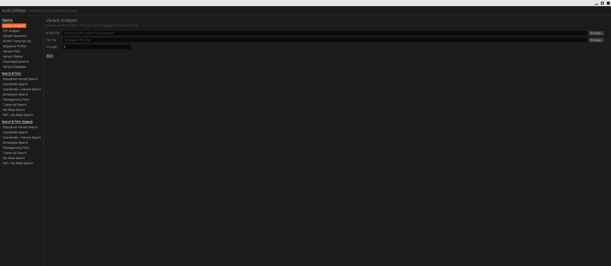

# evaiutilities — desktop GUI

An [egui](https://github.com/emilk/egui)/[eframe](https://github.com/emilk/egui/tree/master/crates/eframe) desktop front end for the evAI variant & genome annotation toolkit
(originally a `clap`-based CLI). All 25 CLI subcommands are available as
forms in the sidebar, grouped into:

- **Pipeline** — Variant Analyzer, GTF Analyze, Variant Sequence, ACMG
  Transcript IDs, Sequence Profile, Variant Filter, Variant Plotter,
  Download Genome, Variant Database.
- **Search & filter** — population/coordinate/annotation/transcript/allele
  search and pathogenicity filtering, current format.
- **Search & filter (legacy)** — the same searches for the older result
  format (the CLI's `*Older` commands).

Each run happens on a background thread, so the UI stays responsive; a log panel at the bottom streams results and errors as jobs finish. File and folder fields have a native "Browse..." picker (via `rfd`).

## Building

```
cargo build --release
./target/release/evai-gui
```

You'll need the Linux GUI dev packages that `rfd`'s GTK-based file picker
and `eframe`'s X11 backend link against, e.g. on Debian/Ubuntu:

```
sudo apt install libgtk-3-dev pkg-config libx11-dev libxkbcommon-dev \
    libxrandr-dev libxi-dev libxcursor-dev libgl1-mesa-dev
```

On macOS/Windows nothing extra is needed beyond a normal Rust toolchain.

## The "Variant Database" command

The original CLI's `VariantDatabase` command talks to PostgreSQL via
`sqlx` + `tokio`. That dependency chain moves fast and needs a fairly
recent Rust toolchain, so it's **not wired in by default** here — the GUI
still shows the command, but running it explains how to enable it.

To enable it:

1. In `Cargo.toml`, uncomment the `sqlx` and `tokio` lines under
   `[dependencies]`.
2. In `src/lib.rs`, remove the `#[cfg(feature = "database")]` line above
   `pub mod variantdatabase;` (or just delete the `#[cfg(...)]` line so
   the module always compiles).
3. In `src/main.rs`, in `run_variant_database`, you can drop the
   `#[cfg(not(feature = "database"))]` branch once the feature is always
   on, or keep building with `--features database`.
4. `cargo build --release --features database`.

The command's "Database URL env var" field expects the *name* of an
environment variable (e.g. `DATABASE_URL`) that holds your Postgres
connection string — set that env var before launching the app.

## Project layout

- `src/lib.rs` — re-exports the original analysis modules as a library
  (`acmgtranscript`, `variantfilter`, `coordinate`, `pathogenicity`, …).
  These are your original files, unmodified except that the CLI-only
  `main.rs`/`args.rs` (clap parsing) were dropped in favor of the GUI.
- `src/main.rs` — the egui application: the command catalog
  (`COMMANDS`), per-command "run" functions that adapt GUI field values
  into calls on the library, and the `eframe::App` implementation
  (sidebar, form grid, log panel).



Gaurav Sablok \
gsablok@proton.me
